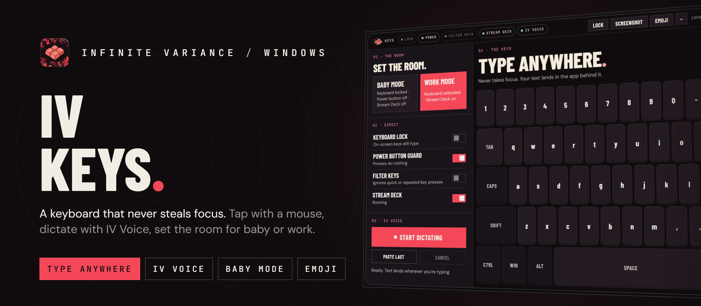
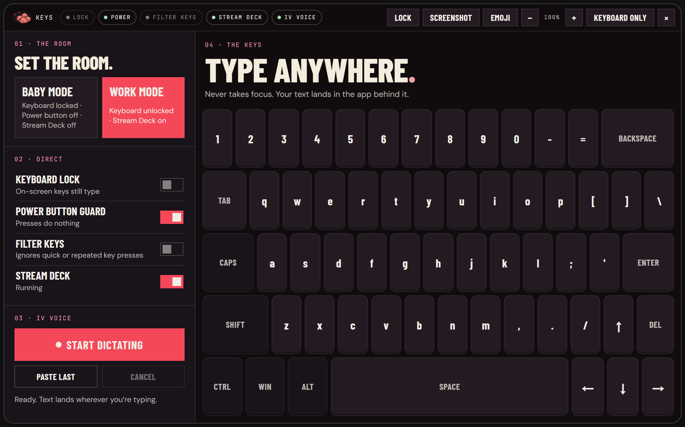
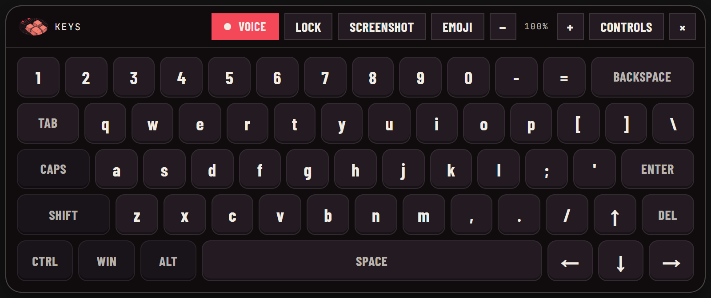
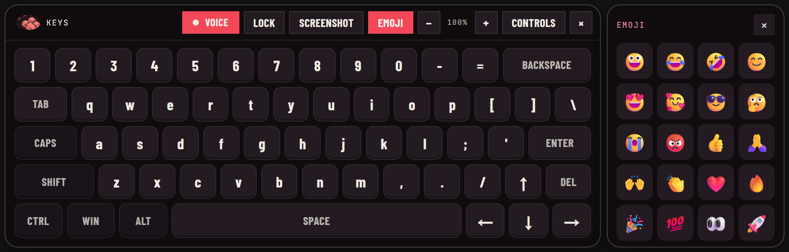

<p align="center">
  
</p>

<p align="center">
  <a href="#install"><b>Install</b></a>
  &nbsp;·&nbsp;
  <a href="#what-you-need">What you need</a>
  &nbsp;·&nbsp;
  <a href="CHANGELOG.md">Changelog</a>
  &nbsp;·&nbsp;
  <a href="https://infinitevariance.ai">Infinite Variance</a>
</p>

# IV Keys

The Infinite Variance on-screen keyboard and family control center for Windows. Tap keys with a mouse or a
touch screen and the text lands in the app you were already using: the keyboard never takes focus. It also
drives [IV Voice](https://github.com/hollisorg/iv-voice) dictation and switches the room between **Baby
mode** (physical keyboard locked, power button off) and **Work mode**.

<p align="center">
  
</p>

## What it does

- **A keyboard that never steals focus.** Keys fire the moment you press them, and every tap counts,
  including quick repeats of the same key. Backspace, Delete and the arrows repeat while held. Shift,
  Ctrl, Alt and Win are one-shot (tap Win then a key for shortcuts like Win + E; tap Win twice for Start),
  and Caps stays on until you tap it again. The legends follow your physical Shift key.
- **Emoji tray**, attached to the right, in full colour.
- **IV Voice built in.** **Voice** starts hands-free dictation and **Done** types the text where you were.
  **Paste last** and **Cancel** are in the full view. If IV Voice isn't running, the first tap starts it,
  and the button follows IV Voice's state live.
- **Baby mode.** Locks the physical keyboard, turns on the power button guard and stops Stream Deck, so a
  curious toddler can't type, switch windows or shut the PC down. The on-screen keys and IV Voice keep
  working.
- **Work mode.** Unlocks the keyboard, turns Filter Keys off and starts Stream Deck. It leaves the power
  button guard on, so whatever is running stays protected while you're at the desk.
- **Keyboard lock.** Blocks every physical key, including the Windows key, Alt + Tab and media keys.
  Unlock on screen, or hold both Ctrl keys for 2 seconds. Ctrl + Alt + Del always works, and the lock lifts
  by itself if IV Keys closes.
- **Power button guard.** Sets the power and sleep buttons to "Do nothing" on the active power plan (no
  admin needed) and puts the old actions back when you switch it off. Holding the power button for about
  4 seconds is a hardware force-off that no software can block; a physical button cover handles that.
- **Screenshot.** Hides IV Keys, opens Windows' snipping tool, and comes back when you're done.
- **Two views.** Keyboard only, or Controls with the room switches, each with its own zoom. It remembers
  the view, zoom and position, and fades to half when the pointer is elsewhere.
- **Tray icon, auto-updates and a per-user installer**, like the other IV apps.

<table>
  <tr>
    <td colspan="2"></td>
  </tr>
  <tr>
    <td colspan="2" align="center"><sub>Keyboard only: the compact view</sub></td>
  </tr>
  <tr>
    <td colspan="2"></td>
  </tr>
  <tr>
    <td colspan="2" align="center"><sub>The emoji tray</sub></td>
  </tr>
</table>

## What you need

- **Windows 10 or 11**, 64-bit.
- **Optional:** [IV Voice](https://github.com/hollisorg/iv-voice) for the Voice button, and
  Elgato Stream Deck if you want the modes to stop and start it.

## Install

IV Keys doesn't have a public download yet. Until it does, build it yourself:

```bash
npm install
node node_modules/electron/install.js   # npm 11 skips Electron's install script
npm run dist
```

That writes `dist\IV-Keys-Setup.exe`, a per-user installer (no admin rights needed). The installer isn't
code-signed yet, so Windows may show **"Windows protected your PC"**: click **More info → Run anyway**.
On first run IV Keys carries over Baby Mode Control's saved view.

## Develop

```bash
npm install
node node_modules/electron/install.js
npm run dev
```

Run these from your own terminal. Apps started from the Claude desktop app's shell have their
AppData redirected into Claude's package folder.

IV Keys 4 is a rebuild of Baby Mode Control (a .NET WinForms app) in the same stack and style as
IV Voice and IV Downloader, with the same features. Releases, code signing and auto-updates work the
same as the other IV apps; see `docs/RELEASING.md` and `docs/CODE-SIGNING.md`.

## How it works

- `src/main/native.js` calls Windows directly through **koffi**, with no compiled addon of our own:
  - `SendInput` types Unicode text, including emoji surrogate pairs, and sends key combos as one
    atomic batch. Arrow keys, Delete and the right-hand modifiers carry the extended-key flag.
  - `SystemParametersInfo` reads and toggles Filter Keys.
  - `GetAsyncKeyState` follows the physical Shift key.
  - The foreground process name and the clipboard sequence number tell when screenshot mode is done.
- `src/main/system.js` covers Stream Deck (tasklist, taskkill, start) and the two modes.
- `src/main/voice.js` is the IV Voice pipe client (`\\.\pipe\iv-voice-<user>`).
- `src/main/lock.js` runs the keyboard lock's low-level hook on its own thread.
- `src/main/index.js` sets up the window:
  - It's `focusable: false` and always on top, and shows without activating.
  - Zoom is Chromium's zoom factor and the window resizes to match.
  - The hover fade and Shift tracking run on a 60 ms tick, and room status refreshes every 3 s,
    none of it on the UI thread.
- The renderer is in `src/renderer/src/`: `App.jsx` (toolbar and views) plus `Keyboard`,
  `Controls` and `EmojiTray`.

### Development self-test

`window.keys.dev.typeTest()` (dev builds only) opens a scratch text box, forces it to the front,
and types `ab`, Backspace, `c😀`, Left and `!` through the real `SendInput` path. It expects
`ac!😀`. It refuses to send any key unless its own window is confirmed to be in front, so a focus
failure can never type into another app.

## Licence

MIT (see `LICENSE`). Third-party components are listed in `THIRD_PARTY_NOTICES.txt`.
